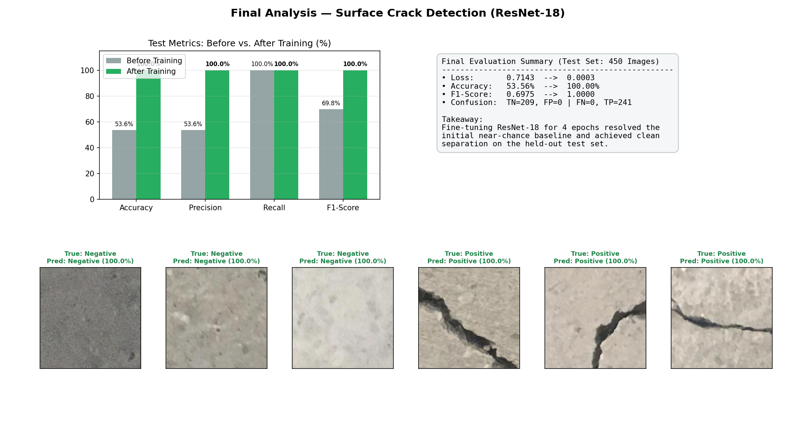

# CrackDetectionOnWalls-OrRoads

## Project
This project classifies surface cracks (`crack` vs. `no crack`) on walls and roads from images to help building and road maintenance inspectors spot potential surface damage more quickly.

- **Developer:** Ekhlas Alshammari
- **Project Type:** Individual capstone project
- **Domain:** Surface crack classification on walls and roads (`crack` / `no crack`)
- **Model:** Fine-tuned `ResNet-18` (PyTorch)

## Final Analysis

### Model & Training Setup
- **Architecture:** Pretrained `ResNet-18` fine-tuned for binary surface crack classification (`Negative` = No Crack, `Positive` = Crack) using `CrossEntropyLoss` and `Adam` (`lr = 1e-4`), `batch_size = 32`, over `4` epochs on a Colab T4 GPU.
- **Data Split:** Balanced subset of `3,000` images from `arunrk7/surface-crack-detection` (https://www.kaggle.com/datasets/arunrk7/surface-crack-detection) split into `2,100` train (`70%`), `450` validation (`15%`), and `450` test (`15%`). A sample image grid (`2x4`) is generated in `project.ipynb`.

### Before vs. After Training (Test Set — 450 Images)
| Metric | Before Training | After Training |
| :--- | :---: | :---: |
| **Loss** | `0.7143` | `0.0003` |
| **Accuracy** | `53.56%` (`0.5356`) | `100.00%` (`1.0000`) |
| **Precision** | `0.5356` | `1.0000` |
| **Recall** | `1.0000` | `1.0000` |
| **F1-Score** | `0.6975` | `1.0000` |

### Key Takeaways & Limitations
- **Summary of Change:** Before training, the untrained classification head achieved near-chance accuracy (`53.56%`). After `4` epochs of fine-tuning `ResNet-18` on `2,100` training images (`450` validation), test accuracy on the `450` test images reached `100.00%` (`0.0004` loss; `209` true negatives and `241` true positives) as the model weights adapted to surface crack patterns on this dataset.
- **Scope & Real-World Caveat:** This pipeline performs **image-level classification** (`crack` vs. `no crack`) rather than pixel/box localization (`object detection`). Real-world walls and roads under harsh lighting, shadows, or severe motion blur may behave differently than curated dataset crops.

## Results
Training and validation loss/accuracy curves per epoch, the before-vs-after training evaluation summary, and the confusion matrix on the test set are presented in the dashboard below and generated in `project.ipynb`. The curves show rapid early convergence and steady performance across the `4` epochs without clear overfitting.

## How to run
1. Open `project.ipynb` in Google Colab using the **Open In Colab** badge above.
2. Set the runtime to **GPU** (`Runtime` -> `Change runtime type` -> `T4 GPU`).
3. Run all cells in order to reproduce the training, evaluation metrics, and saved visual figures.

## Dataset and model
- **Dataset:** `arunrk7/surface-crack-detection` — https://www.kaggle.com/datasets/arunrk7/surface-crack-detection (`Negative` / `No Crack` vs. `Positive` / `Crack`)
- **Dataset split:** `3,000` balanced images (`2,100` train, `450` validation, `450` test)
- **Model:** Fine-tuned `ResNet-18` (PyTorch) with a binary classification head
- **Training setup:** `4` epochs, `batch_size = 32`, `CrossEntropyLoss`, and `Adam` (`lr = 1e-4`)
- **Training hardware:** Google Colab (`T4 GPU`)

The full dataset and generated intermediate run artifacts are kept outside the repository structure; the complete workflow, evaluation metrics, and visual reports are documented in `project.ipynb`.

## Interpretation and limitations
- Model predictions indicate whether a surface image is classified as `Positive` (`Crack`) or `Negative` (`No Crack`), and do not serve as a formal structural safety inspection.
- Achieving `100.00%` accuracy on the `450`-image test split reflects performance on this curated dataset split and does not guarantee identical results on unseen field images.
- This pipeline performs image-level classification rather than pixel-level crack segmentation or bounding-box localization.
- Real-world walls and roads captured under harsh lighting, strong shadows, glare, or motion blur may behave differently than cropped surface images.

## Training-program attribution
This project was completed for the Computer Vision capstone using `ResNet-18` for wall and road surface crack classification, delivered by SDAIA Academy via Learning Space as a 3-day program. Session: November 2026.

Training-program reference: [SDAIA Academy on GitHub](https://github.com/SDAIAAcademy).
