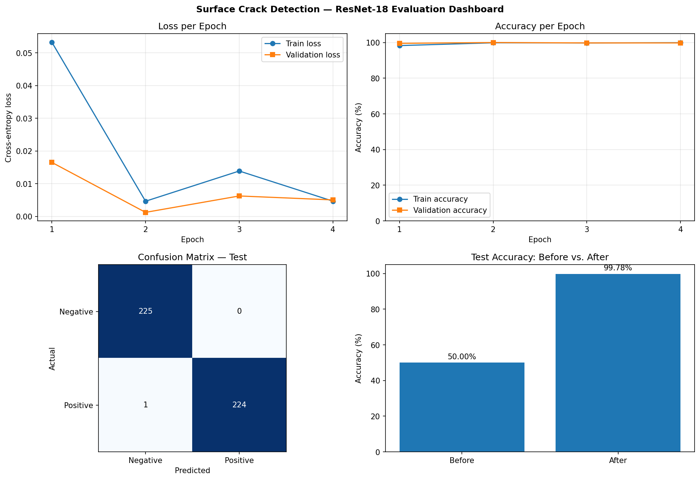

# CrackDetectionOnWalls-OrRoads

## Project
This project classifies surface cracks (`crack` vs. `no crack`) on walls and roads from images to help building and road maintenance inspectors spot potential surface damage more quickly.

- **Developer:** Ekhlas Alshammari, Roa Alnazawi
- **Project Type:** Team capstone project
- **Domain:** Surface crack classification on walls and roads (`crack` / `no crack`)
- **Model:** Fine-tuned `ResNet-18` (PyTorch)
  

## Final Analysis

### Model & Training Setup
- **Architecture:** Pretrained `ResNet-18` (`224x224` input with ImageNet normalization) evaluated before and after fine-tuning for binary surface crack classification (`Negative` = No Crack, `Positive` = Crack) using `CrossEntropyLoss` and `Adam` (`lr = 1e-4`), `batch_size = 32`, over `4` epochs on a Colab T4 GPU (`SEED = 42` with deterministic CUDA settings).
- **Data Sampling & Deduplication:** From the full dataset of `40,000` images in `arunrk7/surface-crack-detection` (https://www.kaggle.com/datasets/arunrk7/surface-crack-detection), a balanced subset of `3,000` unique images (`1,500` Negative and `1,500` Positive) is randomly sampled using `SEED = 42` while skipping exact file duplicates via SHA-256 content hashing (`10` exact duplicates skipped during sampling).
- **Data Split:** The `3,000` selected images are split into `2,100` train (`70%`; `1,050` per class), `450` validation (`15%`; `225` per class), and `450` test (`15%`; `225` per class), accompanied by exact cross-split duplicate verification, split integrity checks, and a sample image grid (`2x4`) generated in `project.ipynb`.

### Before vs. After Training (Test Set — 450 Images)
| Metric | Before Training | After Training |
| :--- | :---: | :---: |
| **Loss** | `[Before Loss]` | `[After Loss]` |
| **Accuracy** | `[Before Acc%]` (`[Before Acc]`) | `[After Acc%]` (`[After Acc]`) |
| **Precision** | `[Before Precision]` | `[After Precision]` |
| **Recall** | `[Before Recall]` | `[After Recall]` |
| **F1-Score** | `[Before F1]` | `[After F1]` |

### Key Takeaways & Limitations
- **Summary of Change:** Evaluates the pretrained `ResNet-18` model before and after `4` epochs of fine-tuning on `2,100` training images (`450` validation) and reports performance on the fixed `450`-image test split using consistent evaluation logic.
- **Scope & Real-World Caveat:** This pipeline performs **image-level classification** (`crack` vs. `no crack`) rather than pixel/box localization (`object detection`). While exact file duplicates are filtered using SHA-256 hashes, visually similar images may still appear across splits, and real-world walls and roads under harsh lighting, shadows, or severe motion blur may behave differently than curated dataset crops.

## Results
Training and validation loss/accuracy curves per epoch, the before-vs-after training evaluation summary, and the confusion matrix on the test set are presented in the dashboard below and generated in `project.ipynb`.

## How to run
1. Open `project.ipynb` in Google Colab using the **Open In Colab** badge above.
2. Set the runtime to **GPU** (`Runtime` -> `Change runtime type` -> `T4 GPU`).
3. Run all cells in order from top to bottom to reproduce the balanced SHA-256 deduplicated subset (`3,000` images), `70/15/15` stratified splits, training, evaluation metrics, and saved visual figures.

## Dataset and model
- **Dataset:** `arunrk7/surface-crack-detection` — https://www.kaggle.com/datasets/arunrk7/surface-crack-detection (`40,000` total images; `Negative` / `No Crack` vs. `Positive` / `Crack`)
- **Dataset split:** `3,000` balanced, SHA-256 deduplicated images (`2,100` train, `450` validation, `450` test)
- **Model:** Fine-tuned `ResNet-18` (PyTorch) with a binary classification head
- **Training setup:** `4` epochs, `batch_size = 32`, `CrossEntropyLoss`, `Adam` (`lr = 1e-4`), and `SEED = 42`
- **Training hardware:** Google Colab (`T4 GPU`)

The full dataset and generated intermediate run artifacts are kept outside the repository structure; the complete workflow, sampling/duplicate checks, evaluation metrics, and visual reports are documented in `project.ipynb`.

## Interpretation and limitations
- Model predictions indicate whether a surface image is classified as `Positive` (`Crack`) or `Negative` (`No Crack`), and do not serve as a formal structural safety inspection.
- Performance on the `450`-image test split reflects this curated dataset split and does not guarantee identical results on unseen field images.
- Exact SHA-256 hash checks prevent identical file duplicates, though visually similar images may still exist across splits.
- This pipeline performs image-level classification rather than pixel-level crack segmentation or bounding-box localization.
- Real-world walls and roads captured under harsh lighting, strong shadows, glare, or motion blur may behave differently than cropped surface images.

## Training-program attribution
This project was completed for the Computer Vision capstone using `ResNet-18` for wall and road surface crack classification, delivered by SDAIA Academy via Learning Space as a 3-day program. Session: November 2026.

Training-program reference: [SDAIA Academy on GitHub](https://github.com/SDAIAAcademy).
